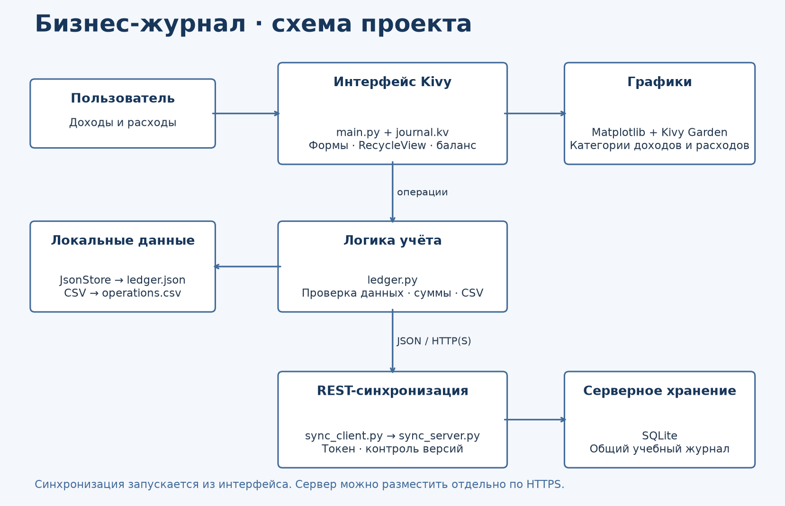
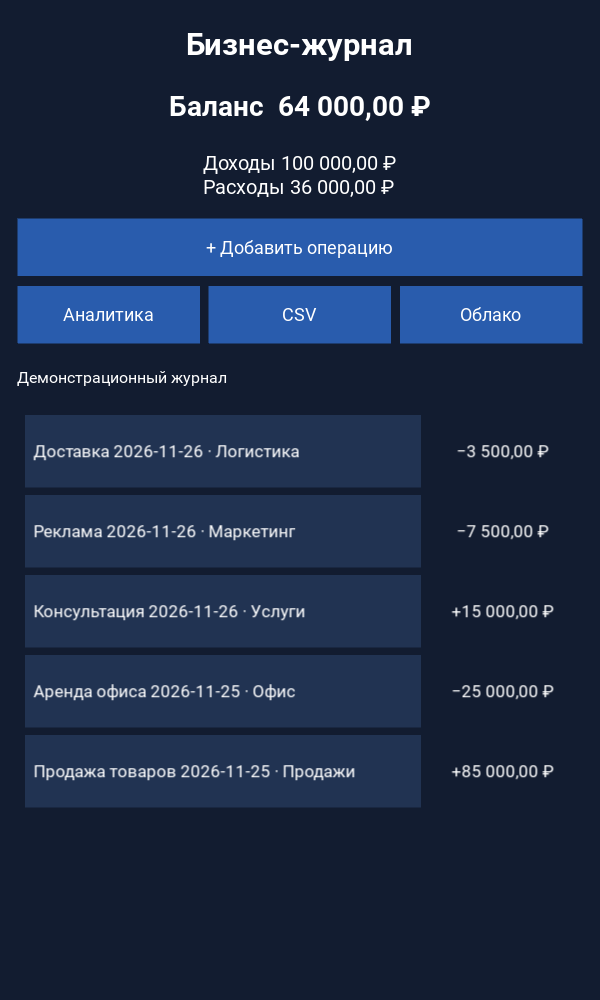
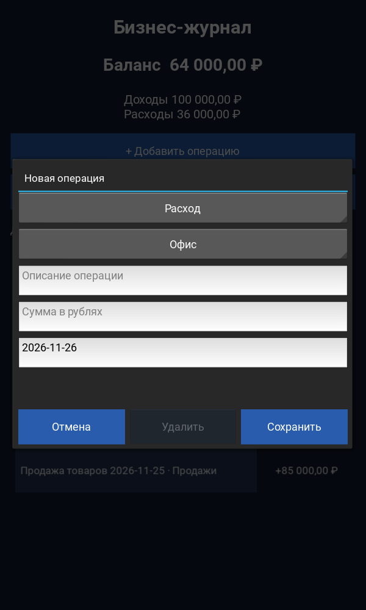
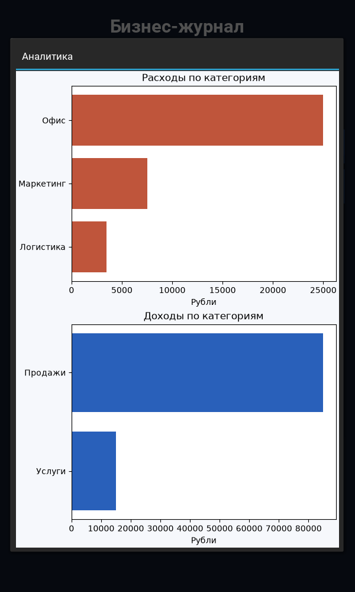

# Бизнес-журнал

Работа Михаила Логинова к лекции № 6 «Разработка мобильного приложения». Приложение на Python и Kivy ведёт журнал доходов и расходов малого бизнеса.

- Добавление, просмотр, редактирование и удаление операций. Нажмите на строку журнала, чтобы её изменить.
- Раздельные категории доходов и расходов, текущий баланс. Суммы хранятся в целых копейках.
- Графики по категориям на Matplotlib через Kivy Garden.
- Локальное хранение в JsonStore, обновляемый список RecycleView и отдельный интерфейс на KV.
- CSV для Excel и ручная синхронизация журнала с REST-сервером.

## Запуск на Windows

В CMD из папки проекта, с Python 3.12:

```cmd
py -3.12 -m venv .venv
.venv\Scripts\python.exe -m pip install -r requirements.txt
.venv\Scripts\python.exe main.py
```

Запускайте файл как обычную программу. Для Windows потребуется графическая сессия с OpenGL. Данные лежат в каталоге приложения Kivy, путь к CSV отображается после экспорта. Для отдельной демонстрации можно задать переменную окружения LEC6_DATA_DIR перед запуском.

## Проверка REST-синхронизации

Откройте второй CMD в папке проекта. Задайте собственный токен длиной от 16 символов и запустите сервер:

```cmd
set EXPENSE_SYNC_TOKEN=REPLACE_WITH_YOUR_DEMO_TOKEN
.venv\Scripts\python.exe sync_server.py
```

В приложении откройте «Облако», укажите http://127.0.0.1:8765 и тот же токен. «Синхронизировать» отправляет локальные изменения или загружает журнал, если локальных правок нет. Примите первую версию на втором клиенте до редактирования. Для второго клиента задайте отдельный LEC6_DATA_DIR. Если другой клиент успел обновить журнал, сервер вернёт конфликт версий. Кнопка «Загрузить с сервера» в этом случае сохранит локальный журнал в before_sync.csv перед получением общей версии.

REST-сервер хранит один общий учебный журнал в SQLite. Для внешнего доступа запустите его за HTTPS-прокси и вводите в приложении HTTPS-адрес. Публичное развертывание и APK в комплект не входят. Локальные данные и токен не предназначены для коммита.

## Проверки

```cmd
.venv\Scripts\python.exe -m unittest -v
```

Тесты работают без графического окна и проверяют суммы, категории, даты, CSV, загрузку с двух клиентов, конфликт версий, удаление и отклонение неверного токена.

Документация: [установка Kivy](https://kivy.org/doc/stable/gettingstarted/installation.html) и [Kivy Garden Matplotlib](https://github.com/kivy-garden/matplotlib).

## Схема проекта

Интерфейс приложения связывает формы операций, расчёты, локальное хранение и REST-синхронизацию. Модуль ledger.py проверяет операции и рассчитывает суммы. Сохранение в JsonStore и запуск синхронизации выполняет LedgerApp в main.py.



## Скриншоты приложения

Снимки получены при запуске приложения на Windows с демонстрационными операциями. Доходы составляют 100 000 рублей, расходы — 36 000 рублей, баланс — 64 000 рублей.

### Главный экран

Список доходов и расходов, баланс и кнопки действий.



### Добавление операции

Форма выбора типа и категории, ввода описания, суммы и даты.



### Аналитика

Графики доходов и расходов по категориям, построенные из того же демонстрационного журнала.


